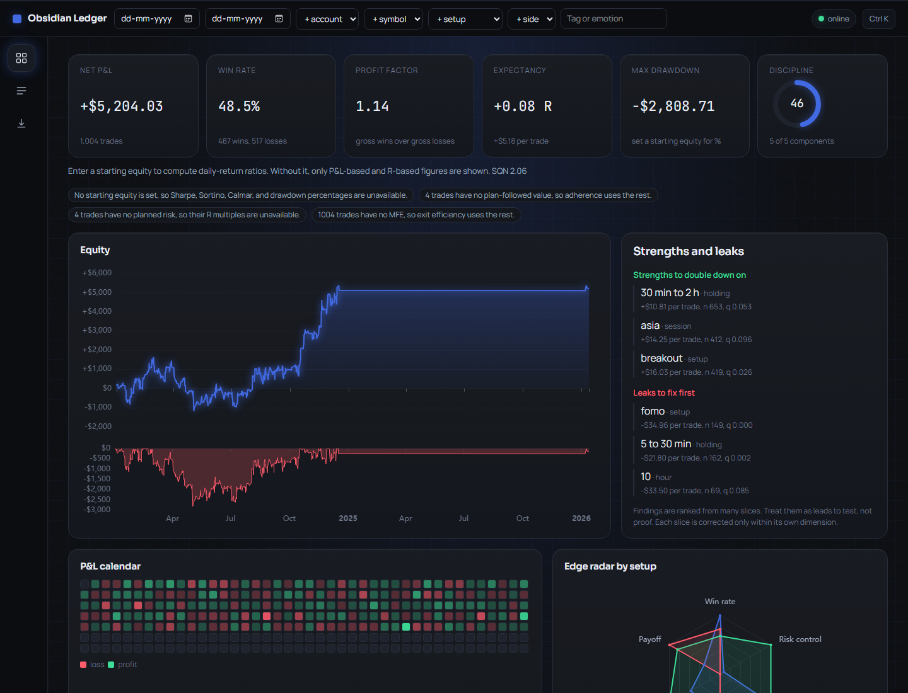

# Obsidian Ledger

Obsidian Ledger is a local-first trading journal and performance review workspace. It ingests a trader's own files, computes deterministic metrics, and gives an optional Coach a tool-backed result to explain. It does not predict markets or issue trade signals.


## Current status

Phases 0 to 3 are built and waiting for review. Phase 1 reads CSV, TSV, TXT, XLSX, XLS, and JSON; detects the broker layout; pairs IBKR fills with FIFO; reports data-quality issues; and stores trades in a local DuckDB file. Phase 2 computes performance metrics, risk, behavior, segment statistics, a discipline score, and what-if simulations, all in deterministic code. Phase 3 adds the Dashboard, Trades, and Import screens, with saved views, a trade drawer for journal notes, and a command palette. The Analytics, Behavior, Simulator, Reports, and Settings screens and the Coach (Phase 5) are not built yet. See `docs/phase-3-screens.md`, `docs/ingestion.md`, `docs/metrics-definitions.md`, and `benchmarks/README.md`.

## Prerequisites

- Node.js 22+
- pnpm 12.18.0+
- Python 3.12
- [uv](https://docs.astral.sh/uv/)

All runtime dependencies are free and open source. Cloud AI is not required.

## Install

```powershell
pnpm install
uv sync --directory api
```

Or run both steps at once with `pnpm bootstrap`, which requires `uv` to be installed already. The name `setup` is avoided because pnpm reserves it for its own command.

## Quick start

From a fresh clone, with Node 22+, pnpm 12, Python 3.12, and uv installed:

```powershell
pnpm bootstrap   # installs web and API dependencies
pnpm seed        # optional: loads the 1,000-trade sample journal
pnpm dev         # starts the API on 127.0.0.1:8000 and the web app on 127.0.0.1:5173
```

Open <http://127.0.0.1:5173>. The web app stays usable when the API is offline, and the health badge shows that state. Run `pnpm dev:api` or `pnpm dev:web` alone if you want one process.

`pnpm reset:data` deletes the local data folder, `api/.ledger-data`. Stop `pnpm dev` first, because the database file is locked while the API has it open.

The API exposes:

- `GET /health` for the local service check
- `GET /` for service metadata
- `GET /docs` for FastAPI's local API documentation
- `POST /api/imports/preview?filename=...` (raw file body) and `POST /api/imports/{preview_id}/commit` to import a trade file. See `docs/ingestion.md`.
- `GET /api/trades` for stored trades with derived equity, drawdown, and loss streaks
- `GET /api/trades/page` for paged, sorted trade rows used by the Trades screen
- `GET /api/trades/{trade_key}` and `PATCH /api/trades/{trade_key}` to read and edit a trade's journal fields (notes, tags, emotion, confidence)
- `GET /api/filter-options` and `GET|POST /api/views`, `DELETE /api/views/{name}` for filter choices and saved views
- `GET /api/dashboard` for the dashboard payload: headline report, equity, daily P&L, R histogram, weekday-hour heatmap, edge radar, and findings
- `GET /api/metrics` for the full analysis report, with filters for date, account, symbol, setup, side, and tag
- `GET /api/segments?by=symbol` for segment tables with sample size and significance
- `POST /api/simulate` for what-if trading rules. See `docs/phase-2-metrics.md`.

Copy `.env.example` to `.env` only when changing the local API port or allowed browser origins. No telemetry is configured.

## Validate

```powershell
pnpm test
```

```powershell
pnpm check      # lint, typecheck, and unit tests for the web app and the API
pnpm test       # check plus the production web build
pnpm test:e2e   # Playwright: import, dashboard, trades, filters, keyboard, axe, and screenshots
pnpm bench      # benchmark at 1k, 5k, and 10k trades. Writes benchmarks/RESULTS.md
```

`pnpm check` runs ESLint, strict TypeScript, Vitest, Ruff, Pyright, and pytest (141 API tests, 23 web unit tests). `pnpm test:e2e` builds the web app, starts the API on a temporary data folder, and drives the built app in Microsoft Edge. Screenshots from that run are saved to `docs/screens/`.

## Sample data and benchmarks

The committed fixtures are under `samples/`. Each generated CSV has a manifest with its SHA-256 and totals, so the generator's output can be checked.

- MT5 closed positions
- TradingView entry/exit rows
- IBKR raw executions
- a deliberately messy journal containing duplicate, invalid, European-format, formula-like, and instruction-like values
- a 1,000-row canonical synthetic preview
- a 100,000-row canonical synthetic journal

The 100k file is committed. `pnpm bench` generates 1k, 5k, and 10k journals into `benchmarks/out/`, which git ignores, and creates them when they are missing. To generate another size by hand:

```powershell
uv run --directory api python ../benchmarks/generate_trades.py --rows 1000000 --out ../benchmarks/out/synthetic_1m.csv
```

Each generated CSV gets a neighboring JSON manifest with row count, seed, SHA-256, win count, and P&L total. The generator is deterministic for a fixed seed.

## Project map

- `web/` React + TypeScript + Vite client and design system
- `api/` Python + FastAPI service and future ETL/analytics layers
- `samples/` local ingestion fixtures
- `benchmarks/` deterministic generator and performance-input documentation
- `docs/` architecture, metrics definitions, and architecture decision records

## Privacy boundary

Trade files are not uploaded anywhere. The API stores them in a local DuckDB file and Parquet folder under `.ledger-data/`, which git ignores. The API accepts requests only from the local web origins. Optional cloud LLM support will be opt-in, aggregate-only by default, and separated from deterministic calculations. API keys must never be stored in the database or logs.

## License

The project is MIT licensed (see `LICENSE`). Every dependency and its license is listed in `docs/dependencies.md`. Two build-time packages use weak copyleft (MPL-2.0) and are not shipped in the browser bundle.

## Ingestion quickstart

```powershell
# Preview a file (returns detected layout, questions, and assumptions)
Invoke-RestMethod -Uri "http://127.0.0.1:8000/api/imports/preview?filename=ibkr_executions.csv" -Method Post -InFile samples\ibkr_executions.csv -ContentType "application/octet-stream"
```

Then commit with the returned `preview_id`. The TradingView sample needs `default_symbol` first.

## Design preview

The dashboard below shows 1,000 synthetic trades imported from `samples/synthetic_preview.csv`. It was captured from the production build served by `pnpm -C web preview`, with the API running.



The earlier overview screenshot shows the Phase 0 shell with the API online. Run `pnpm dev:web` for the interactive shell and use `Ctrl+K` to open the command palette, which also contains the color-blind palette toggle.
