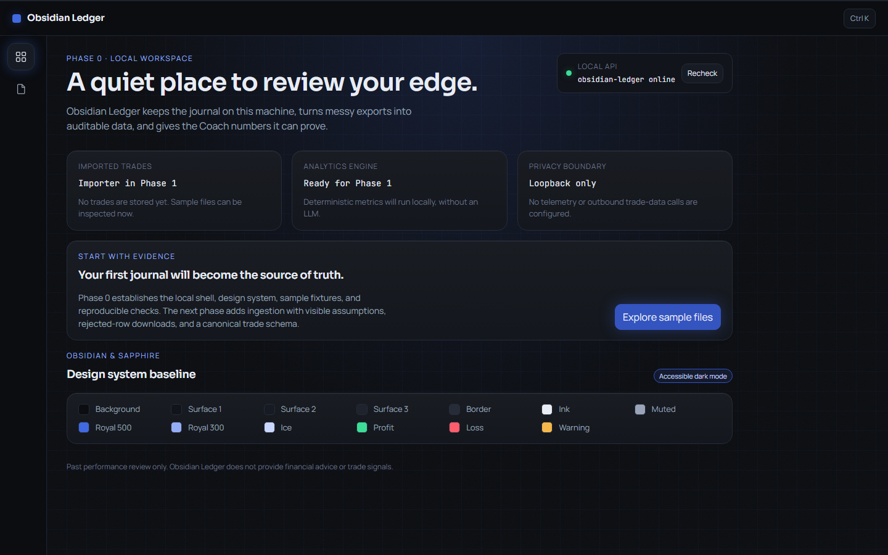

# Obsidian Ledger

Obsidian Ledger is a local-first trading journal for importing completed trades, reviewing deterministic performance metrics, and optionally asking an AI Coach to explain its evidence. It does not predict markets or issue trade signals.



## Status

Phases 0–6 are implemented. The app includes CSV, TSV, text, XLSX, XLS, and JSON imports; broker-layout detection; FIFO pairing for IBKR fills; a local DuckDB/Parquet store; deterministic metrics, behavior analysis, and simulations; Overview, Trades, Import, Analytics, Behavior, Simulator, and Settings screens; and an optional tool-backed Coach. Phase 6 adds upload and export hardening, keychain credential storage, security and dependency auditing, documentation, and performance measurements up to 10,000 trades.

There is no Reports screen or application-generated PDF export. Exported HTML can be printed to PDF in a browser. Ollama is not connected to the current app; see the [user guide](docs/user-guide.md) for this limitation and other known issues.

## Requirements

- Node.js 22 or newer
- pnpm 12.18.0
- Python 3.12
- [uv](https://docs.astral.sh/uv/)

## Install and run

From the repository root in PowerShell:

```powershell
pnpm bootstrap
pnpm seed        # optional: load the 1,000-trade sample journal
pnpm dev
```

Open <http://127.0.0.1:5173>. The API listens only on `127.0.0.1:8000`; the web client remains usable when the API is offline. `pnpm dev:api` and `pnpm dev:web` start either service alone. Copy `.env.example` to `.env` only to change local ports or the allowed browser origins. No telemetry is configured.

See the [user guide](docs/user-guide.md) for importing files, using the Coach, privacy controls, and exports. The [architecture](docs/architecture.md), [ingestion notes](docs/ingestion.md), and [metrics definitions](docs/metrics-definitions.md) describe implementation details.

## Validation

```powershell
pnpm install --frozen-lockfile
uv lock --check
pnpm check       # web lint/typecheck/unit tests and API Ruff/Pyright/pytest
pnpm test         # web checks/build plus API checks/tests
pnpm test:e2e     # browser tests using installed Microsoft Edge
pnpm bench        # ten runs at 1k, 5k, and 10k trades; never above 10k
```

Latest Phase 6 validation: 332 API tests, 43 web unit tests, and 78 browser tests. `pnpm check` runs ESLint, TypeScript, Vitest, Ruff, Pyright, and pytest. Playwright runs serially with an isolated temporary API data directory and the installed Edge browser; it does not download a browser. The browser suite writes screenshots to ignored `docs/screens/`; committed reference images stay in `docs/screenshots/`. See [the test report](docs/test-report.txt) and [benchmark results](benchmarks/RESULTS.md).

## Data and privacy boundary

Imports, the DuckDB database, Parquet files, and ZIP exports stay on this computer. The API accepts browser requests only from configured local origins. Provider keys are stored in the operating-system keychain, not in the database or exports. The Coach works with AI turned off; optional cloud AI requires user selection and consent, and sends only the selected result data to that provider. Review the provider's privacy and billing terms before enabling it. The app has no telemetry.

CSV exports prefix spreadsheet-formula-like values with an apostrophe after serialization; JSON numeric values remain numbers. ZIP exports are assembled locally and may contain financial and behavioral journal data, so keep them in a secure location.

## Known issues

- The app does not currently have an Ollama adapter. Installing Ollama and `qwen2.5:7b` does not connect a local model to this build.
- The npm audit retains one high Zod advisory and lower-severity advisories; details and mitigation rationale are in [security notes](docs/security.md).
- Lighthouse and 10,000-trade performance measurements, including their ranges and limitations, are recorded in [benchmark results](benchmarks/RESULTS.md).

## Samples and project map

The committed fixtures are under `samples/`, including a deliberately messy journal, a 1,000-row preview, and an intentional 100,000-row synthetic sample. The benchmark command is capped at 10,000 trades and stores generated inputs under ignored `benchmarks/out/`.

- `web/` — React, TypeScript, and Vite client
- `api/` — Python and FastAPI service
- `samples/` — import fixtures and manifests
- `benchmarks/` — deterministic generators, harness, and results
- `docs/` — user guide, architecture, security notes, and ADRs

The project is MIT licensed; dependency licenses are listed in [docs/dependencies.md](docs/dependencies.md).

## License

MIT; see [LICENSE](LICENSE).
