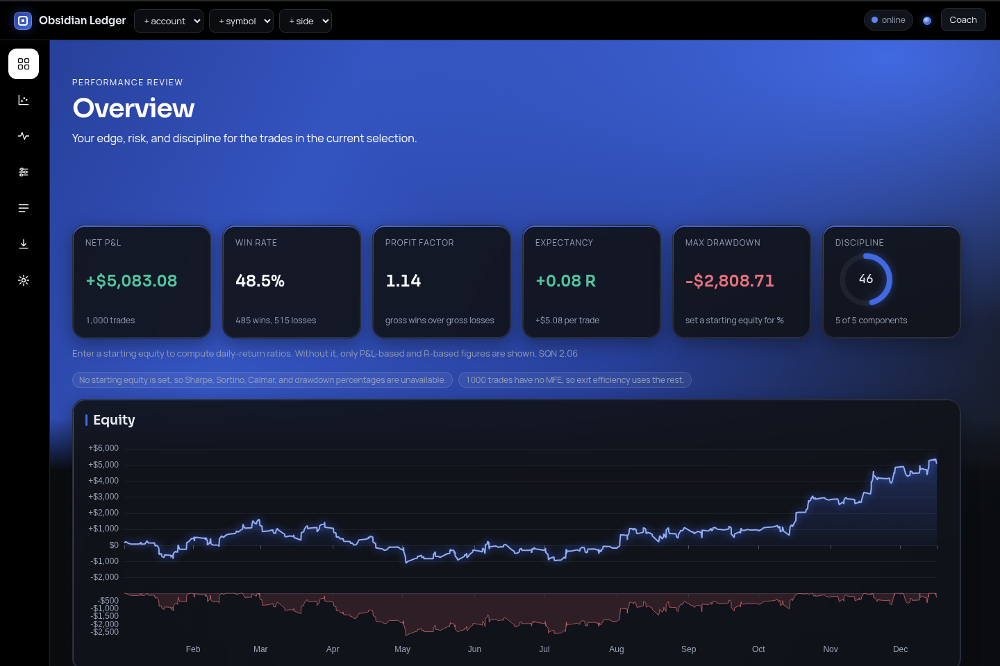

# Obsidian Ledger

Obsidian Ledger is a local-first trading journal for reviewing completed trades. Import a journal, examine performance and behavior, and use the Coach to explain the evidence. All calculations run locally. The journal is for historical review and education.



## Features

- **Import and reconcile.** Import CSV, TSV, text, XLSX, XLS, or JSON. Review detected columns, assumptions, capabilities, and rejected rows before committing. IBKR execution imports can pair fills using FIFO.
- **Review a journal.** Filter by account, symbol, and side. The Dashboard shows headline metrics, equity, a P&L calendar, an edge radar, and a weekday-by-hour heatmap. Use Trades to inspect individual records and edit journal fields.
- **Investigate results.** Analytics includes segment comparisons, Trade Constellation, MAE/MFE, streaks, fee drag, and a Monte Carlo fan. Behavior and Simulator cover trading patterns and what-if rules.
- **Use Coach with or without AI.** The rules-based report runs locally. Optional AI explains computed tool results through a provider you configure and authorize.
- **Keep and export your data.** The local DuckDB and Parquet store holds the journal and source records. Export a workspace ZIP from Settings or export a Coach report and print the HTML to PDF.

## Get started

**Requirements:** Node.js 22+, pnpm 12.18.0, Python 3.12, and [uv](https://docs.astral.sh/uv/).

Run these commands from the repository root in PowerShell or a terminal:

```text
pnpm bootstrap
pnpm dev
```

Open <http://127.0.0.1:5173>. The launcher starts Vite on port 5173 and FastAPI on port 8000, both on `127.0.0.1`. For a demo, run `pnpm seed` before starting the servers to load 1,000 synthetic trades. For your own data, open **Import**, review the preview, and confirm the import.

The default setup works without an `.env` file. The development launcher uses fixed ports. See the [local configuration and troubleshooting guide](docs/user-guide.md#local-configuration) for settings and separate service commands.

## Privacy

The browser sends imports to the local API, which stores the journal on your machine. The app has no telemetry. AI is optional. If you consent to using a cloud provider, the provider receives the selected result data. Aggregate-only sharing is the default, and provider keys are stored in the operating system's keychain. See the [privacy guide](docs/user-guide.md#privacy-choices) and [security notes](docs/security.md).

## Development

Run the core GitHub Actions checks from the repository root:

```text
pnpm install --frozen-lockfile
uv lock --check --directory api
uv sync --directory api --frozen
pnpm test
```

| Command | Use |
| --- | --- |
| `pnpm check` | Run lint, type checks, and unit/API tests. |
| `pnpm test` | Run web and API checks and build the production frontend. |
| `pnpm test:e2e` | Run Playwright with isolated sample data. Microsoft Edge is the default; set `E2E_BROWSER_CHANNEL=chrome` to use installed Google Chrome. Stop `pnpm dev` first so the runner can start its own services. |
| `pnpm bench` | Run the performance harness for 1,000, 5,000, and 10,000 synthetic trades. |

See the [validation report](docs/test-report.txt) for dated results and [CI](.github/workflows/ci.yml) for the workflow.

## Documentation

| If you want to… | Start here |
| --- | --- |
| Use the app or configure local services | [User guide](docs/user-guide.md) · [Accessibility](docs/accessibility.md) |
| Prepare an import or try sample trades | [Import reference](docs/ingestion.md) · [Sample files](samples/README.md) |
| Understand results or implementation | [Metrics definitions](docs/metrics-definitions.md) · [Architecture and decision records](docs/architecture.md) |
| Review privacy, deployment boundaries, or dependencies | [Network](docs/network.md) · [Threat model](docs/threat-model.md) · [Dependencies and licenses](docs/dependencies.md) |
| Reproduce performance measurements | [Benchmark commands](benchmarks/README.md) · [Recorded results](benchmarks/RESULTS.md) |
| Report a vulnerability privately | [Security policy](SECURITY.md) |

The project is licensed under the [MIT License](LICENSE).
