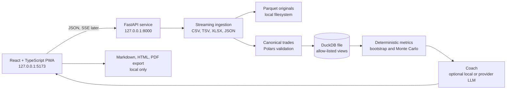

# Architecture

## Boundaries

- The browser talks to a FastAPI process bound to `127.0.0.1`; default CORS allows only the local Vite origins.
- Raw uploads and the DuckDB database stay on the user's machine. The browser does not send files to a hosted service.
- Deterministic Python code owns parsing, normalization, arithmetic, confidence intervals, simulations, and report evidence.
- An optional Coach can call typed read tools to explain tool results. It never becomes the source of a number.
- `run_sql` will be a single-statement, `SELECT`-only interface over allow-listed views with row and time limits.
- User-authored write actions such as notes and goals require explicit confirmation.

## Phase boundaries

Phase 0 provides the shell, local health boundary, visual tokens, fixture contracts, and reproducible checks. Phase 1 adds ingestion and canonical storage. Phase 2 adds metrics. Later phases add charts, Coach tools, reports, and performance and accessibility hardening.
