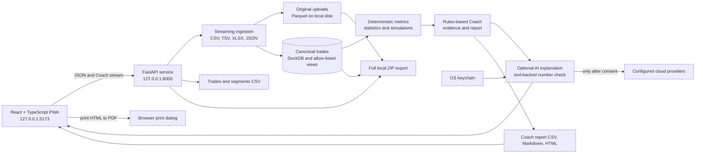

# Architecture

## Boundaries

- The browser talks to a FastAPI process bound to `127.0.0.1`; default CORS allows only the local Vite origins.
- Raw uploads and the DuckDB database stay on the user's machine. The browser does not send files to a hosted service.
- Deterministic Python code owns parsing, normalization, arithmetic, confidence intervals, simulations, and report evidence.
- An optional Coach can call typed read tools to explain tool results. It never becomes the source of a number; unsupported figures are withheld.
- Provider keys are stored in the OS keychain. External model calls require explicit consent; aggregate-only data is the default.
- CSV cells are neutralized after serialization, including negative numeric-looking cells. JSON numeric values stay numeric.
- ZIP exports are assembled locally and contain the selected data and original uploads.
- The current provider catalog has no Ollama adapter. Installing Ollama does not connect it to this build.
- `run_sql` will be a single-statement, `SELECT`-only interface over allow-listed views with row and time limits.
- User-authored write actions such as notes and goals require explicit confirmation.

## Phase boundaries

Phases 0–5 provide the local shell, ingestion, deterministic metrics, analytics screens, Coach tools, and optional AI explanations. Phase 6 hardens upload and export boundaries, records validation and performance results, and documents the system. A Reports screen and application-generated PDF export are out of scope.

## Architecture decision records

- [0001 — Local-first storage](adr/0001-local-first-storage.md)
- [0002 — Numbers come from code](adr/0002-numbers-come-from-code.md)
- [0003 — Monorepo tooling](adr/0003-monorepo-tooling.md)
- [0004 — Commit the synthetic 100k sample](adr/0004-commit-synthetic-100k-sample.md)
- [0005 — ECharts for dashboard charts](adr/0005-echarts-for-dashboard-charts.md)
- [0006 — TanStack Virtual without a table library](adr/0006-tanstack-virtual-without-table.md)
- [0007 — No motion library](adr/0007-no-motion-library.md)
- [0008 — CSS grid calendar and heatmap](adr/0008-css-grid-calendar-and-heatmap.md)
- [0009 — Ollama as the only local option; no new paid providers](adr/0009-ollama-local-model-no-new-paid-providers.md)
- [0010 — Provider keys in the OS keychain](adr/0010-provider-keys-in-the-os-keychain.md)
- [0011 — Number checking for AI answers](adr/0011-number-checking-for-ai-answers.md)
- [0012 — Control false discoveries in Coach findings](adr/0012-control-false-discoveries-in-coach-findings.md)
- [0013 — PDF through the browser print dialog](adr/0013-pdf-through-the-browser-print-dialog.md)
