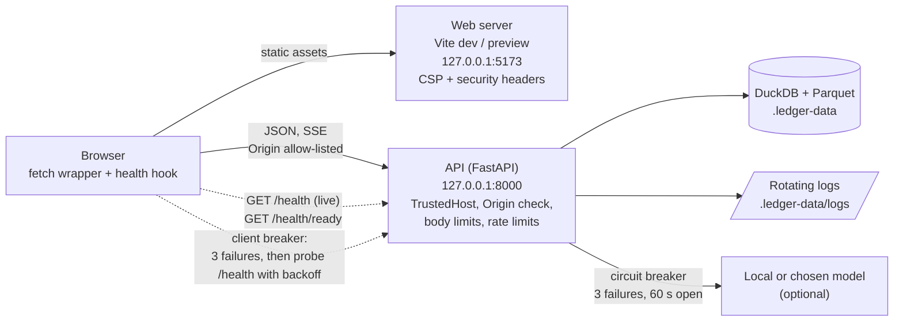

# Network structure and resilience

Everything runs on one machine. The browser talks to a static web server and to an API that listens on loopback only.

## Boundaries

| Layer | Control |
| --- | --- |
| Bind address | The API and web server bind to `127.0.0.1` only (`scripts/dev.mjs`, Playwright config). |
| Host header | `TrustedHostMiddleware` allows `127.0.0.1` and `localhost`. Other hosts get 400, which blocks DNS rebinding. |
| Origin header | A request with an `Origin` that is not allow-listed is rejected with 403, including simple cross-origin POSTs. A request with no Origin (curl, tests) passes. |
| Body size | Every endpoint has a limit; uploads have their own larger cap. Oversized bodies get 413. |
| Heavy jobs | Report, simulate and import commit share a concurrency limit of 2. Extra callers get 503 `busy` at once instead of queueing. |
| Rate limits | A per-client request budget stops runaway loops. Over the budget gets 429 with `Retry-After`. |
| Timeouts | The API cancels a request after 120 s (504 `request_timeout`); the web fetch wrapper aborts after its own timeout via `AbortController`. |
| Writes | Uploads and exports are written to a temp file and renamed. A crash leaves the old file intact. |
| Snapshots | The database file is copied before a wipe or schema change. The last 3 are kept. |
| Logs | Rotating files under `.ledger-data/logs` with a size cap. Notes, keys, trade ids and file names are never logged. |

## Health endpoints

- `GET /health` is liveness. It answers `200` with `{status, service, version}` whenever the process is up.
- `GET /health/ready` checks that the database opens, the data folder is writable and disk space is sufficient. Results:
  - `ready`: all checks pass.
  - `degraded`: the app works but something optional is wrong, for example the AI model is unreachable.
  - `down`: the database cannot be opened or the data folder is not writable. The endpoint answers 503.
- A locked database returns a plain message telling the user to close the other copy of the app.

## Breakers

**Model provider (API).** After 3 consecutive failures the provider is marked unavailable for 60 s. The deterministic report keeps working and readiness reports `ai: unavailable`. After 60 s one trial call is allowed; a success closes the breaker.

**API connection (browser).** After 3 consecutive connection failures the web client opens its breaker: new calls fail immediately with `api_offline` and the badge shows Offline. `useHealth` then probes `/health` with exponential backoff (1 s, 2 s, 4 s, up to 30 s) instead of hammering. The first successful probe closes the breaker.

## Browser fetch behaviour

- One wrapper (`web/src/lib/api.ts`) applies a timeout through `AbortController`.
- GET requests retry up to 3 attempts with exponential backoff and jitter on network errors and 502/503/504. POST and PATCH are never retried.
- The UI distinguishes **API offline**, **API degraded**, **AI unavailable** and **version mismatch**. Cached query data stays on screen while the badge reads "offline · stale".
- The Coach SSE stream reconnects automatically if it drops after opening. A stream that never opens fails at once with a clear message; "Run again" starts a fresh stream.

## Process supervision

`scripts/dev.mjs` starts the API and web server. It restarts a crashed API with capped exponential backoff, detects a busy port and prints which port is taken, and passes the child exit code through.

## Verification

| Behaviour | Test |
| --- | --- |
| Wrong Host rejected, unlisted Origin rejected, oversized body rejected | `api/tests/security/test_api_hardening.py` |
| Heavy-job limit, ready endpoint degraded and down, database-locked message, atomic write on simulated crash, model breaker open and close | `api/tests/test_resilience.py`, `api/tests/test_health.py` |
| Notes, trade ids and file names absent from logs; no free-form SQL tool | `api/tests/security/test_data_handling.py` |
| API refused mid-session, stalled health probes, degraded, AI unavailable, version mismatch, dropped SSE stream, recovery | `web/e2e/chaos.spec.ts` |

## If deployed publicly (documented only, not built)

This app is designed for one user on one machine. If it were ever hosted, the minimum would be:

1. A reverse proxy (Caddy or nginx) terminating HTTPS with an automatic certificate.
2. The API stays bound to `127.0.0.1`, reachable only through the proxy.
3. Firewall: only 443 open to the world, and 22 restricted to known addresses.
4. An access-control layer in front of everything (SSO, or at least proxy basic auth with a strong password and a VPN or IP allow-list). The app has no accounts of its own.
5. No real trade data on a public instance; use synthetic samples.
6. Set the allowed-origins setting to the public HTTPS origin and the trusted hosts to the public host name.
7. Rate limiting at the proxy in addition to the API limits.
8. Scheduled backups of `.ledger-data`, stored off the machine and encrypted.
9. A free uptime monitor (for example UptimeRobot) polling `GET /health`.
